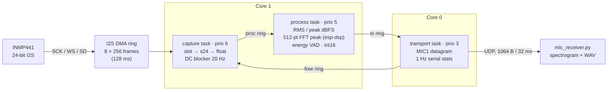

# ESP32 + INMP441 audio pipeline

[](https://github.com/Ri4ards2006/esp32-inmp441-mic/actions/workflows/ci.yml)
[](LICENSE)

Firmware for an **ESP32-WROOM-32D** with an **InvenSense INMP441** I2S MEMS microphone:
24-bit capture over I2S DMA, a non-blocking three-task FreeRTOS pipeline, on-device DSP
(level, FFT peak frequency, voice activity) and a UDP stream to a Python receiver that
shows a live spectrogram and records WAV.

> Status: builds and passes host tests in CI. Acoustic performance (noise floor,
> frequency response) and on-hardware timing are **not measured yet** — see
> [docs/measurement.md](docs/measurement.md) for the procedure and the open TODOs, and
> [AUDIT.md](AUDIT.md) for the baseline review this work started from.

## Wiring

| INMP441 pin | ESP32 pin | GPIO | Direction | Notes |
| --- | --- | --- | --- | --- |
| VDD | 3V3 | – | power | 3.3 V only, never 5 V |
| GND | GND | – | ground | common ground |
| L/R | GND | – | strap | GND = left slot (firmware default `MIC_I2S_SLOT=0`); VDD = right slot (`-DMIC_I2S_SLOT=1`) |
| SCK | D14 | GPIO 14 | ESP32 → mic | bit clock, fs × 64 = 1.024 MHz at 16 kHz |
| WS | D15 | GPIO 15 | ESP32 → mic | word select, = fs. GPIO 15 is a strapping pin, see [wiring.md](docs/hardware/wiring.md) |
| SD | D32 | GPIO 32 | mic → ESP32 | 24-bit data, MSB first |
| – | – | GPIO 2 | output | on-board LED (used by the KWS firmware only) |

Pins are defined in [`include/config.h`](include/config.h). Layout and decoupling notes:
[docs/hardware/wiring.md](docs/hardware/wiring.md). Fault finding:
[docs/hardware/mic_diagnostics.md](docs/hardware/mic_diagnostics.md).

## Pipeline



- **Frames**: 512 samples (32 ms at 16 kHz) from a static pool of 8, passed by pointer
  through lock-free single-producer/single-consumer rings. Every frame has exactly one
  owner, so no locks are needed and no ring push can fail.
- **No blocking between stages**: capture only waits for DMA (100 ms timeout). If the
  network is slow, frames pile up in the tx ring, the free ring runs empty and capture
  *drops and counts* whole frames — it never stalls the I2S DMA.
- **Observability**: the serial port prints once per second
  `[dsp ] rms=… peak=… f0=… floor=… vad=…` and
  `[pipe] cap= drop= proc= sent= err= i2s_to= proc_us=last/max`.
- **Wire format**: 40-byte little-endian header (seq, sample index, features, drop
  counter) + int16 PCM, specified in [`lib/audio_dsp/src/packet.h`](lib/audio_dsp/src/packet.h).

Why the I2S settings are what they are (32-bit slots, Philips format, stereo capture
with software slot selection, `>> 8`, scaling by 2²³, DC blocker) is documented in
[`lib/audio_dsp/src/sample_format.h`](lib/audio_dsp/src/sample_format.h) and
[`src/audio_input.cpp`](src/audio_input.cpp).

## Build & run

Requirements: PlatformIO Core, [uv](https://docs.astral.sh/uv/) for the receiver.

```bash
# 1. WiFi + receiver address (optional; without it the firmware runs serial-only)
cp include/secrets.example.h include/secrets.h   # edit SSID, password, PC IP

# 2. Build, flash, watch telemetry
pio run -e esp32dev -t upload
pio device monitor

# 3. Receive on the PC (live spectrogram, optional WAV)
uv run tools/receiver/mic_receiver.py --port 5005 --wav capture.wav
uv run tools/receiver/mic_receiver.py --no-plot --wav capture.wav   # headless

# No hardware? Send a synthetic sweep to a running receiver:
uv run tools/receiver/mic_receiver.py --simulate 127.0.0.1:5005
```

Tests (also run in CI):

```bash
pio test -e native                                                        # C++ DSP / ring / packet
uv run --no-project --with numpy --with pytest pytest -q tools/receiver   # receiver
```

## Build environments

| Env | Purpose |
| --- | --- |
| `esp32dev` (default) | Pipeline firmware at 16 kHz. Builds from a clean clone. |
| `esp32dev-kws` | Previous Edge Impulse "hello" keyword spotter (15.36 kHz → 3.84 kHz, LED on GPIO 2). Needs the exported SDK in `lib/edge-impulse-sdk/` (gitignored), so it is not built in CI. Data collection helper: `scripts/edge-impulse-connect.sh`. Known limitations of this path are listed in [AUDIT.md](AUDIT.md) (F2, F3). |
| `native` | Host unit tests for `lib/audio_dsp` (Unity). |

## Repository layout

```
include/            config.h (pins, rates, task params), audio_input.h, secrets.example.h
lib/audio_dsp/src/  pure C++, host-tested: sample_format.h, audio_dsp.*, spsc_ring.h, packet.h
src/                audio_input.cpp (I2S driver), app_pipeline.cpp, app_kws.cpp
src/pipeline/       pipeline.* (tasks), spectrum.* (esp-dsp FFT), transport.* (WiFi/UDP)
test/               Unity tests for env:native
tools/receiver/     mic_receiver.py + pytest
docs/               measurement.md, PORTFOLIO.md, architecture.md, scaling.md, hardware/
```

## Documentation

- [AUDIT.md](AUDIT.md) — baseline review of the original firmware
- [docs/measurement.md](docs/measurement.md) — noise floor / frequency response procedure
- [docs/PORTFOLIO.md](docs/PORTFOLIO.md) — project summary (EN / DE)
- [docs/architecture.md](docs/architecture.md), [docs/scaling.md](docs/scaling.md) —
  earlier design notes for the KWS firmware (written before this pipeline)

## License

MIT, see [LICENSE](LICENSE).
